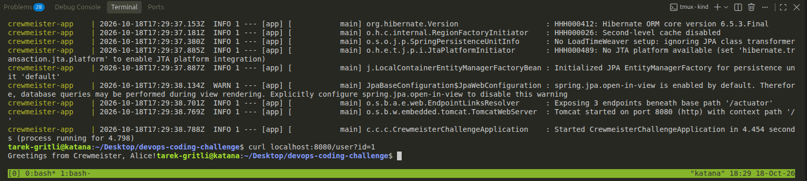
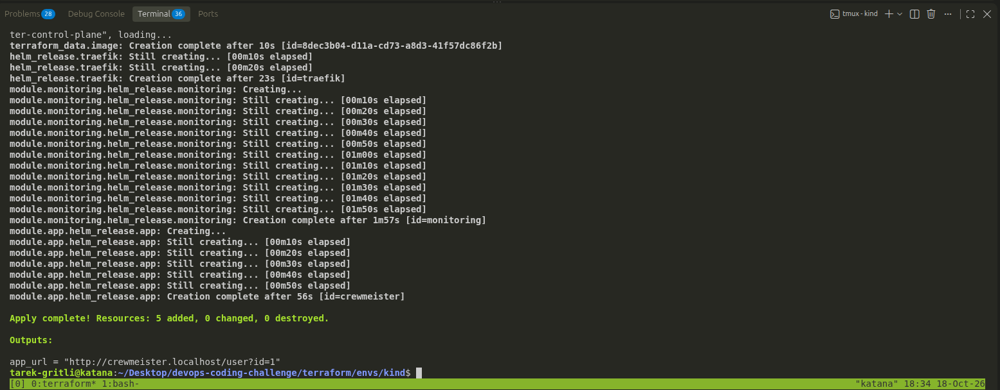
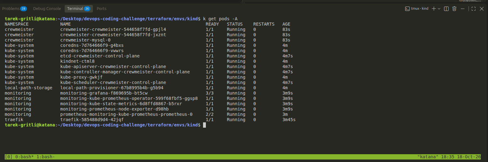
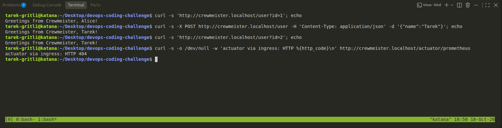
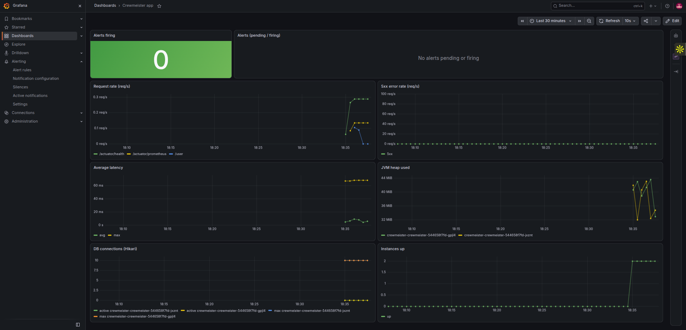
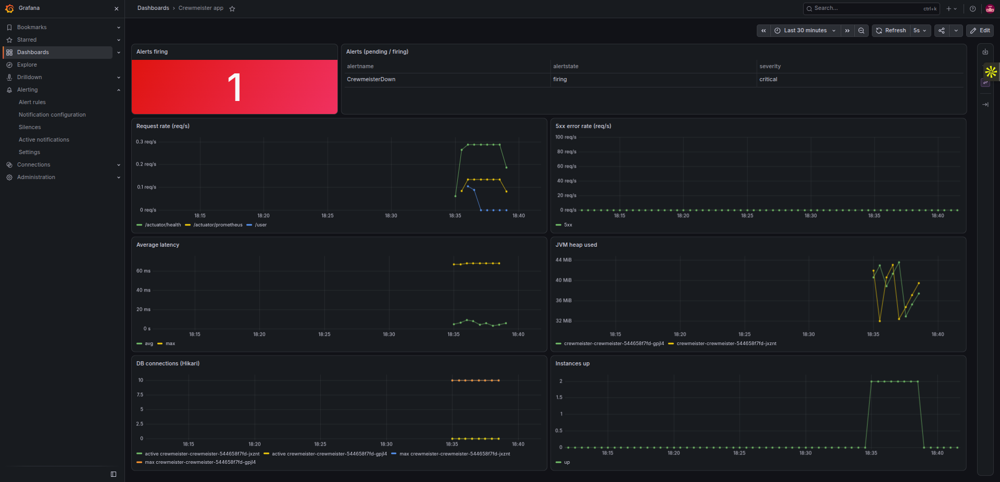
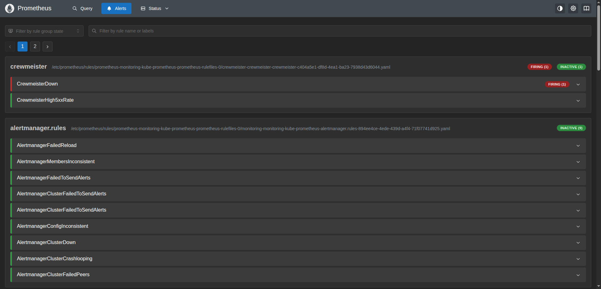
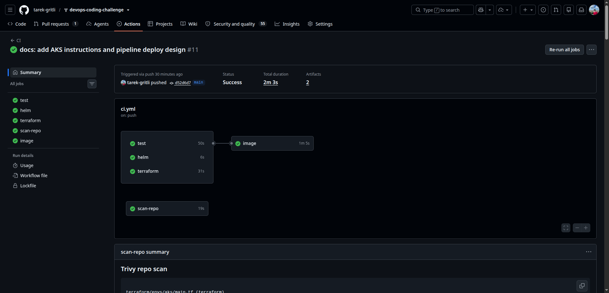
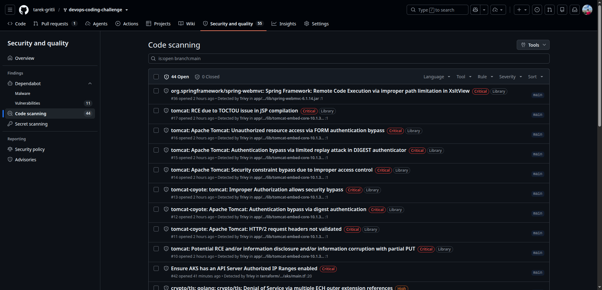

# Crewmeister DevOps Challenge

A Spring Boot user API (Java 17, MySQL, Flyway) packaged with Docker, deployed with a Helm chart
through Terraform onto a local Kubernetes cluster ([kind](https://kind.sigs.k8s.io/)), monitored with
Prometheus and Grafana, and built, tested and scanned by GitHub Actions.

Everything runs locally with free, public tools, no cloud account needed. An optional environment for
Azure Kubernetes Service (AKS) reuses the same chart and Terraform modules.

## Contents

- [What was asked and where it is](#what-was-asked-and-where-it-is)
- [Architecture](#architecture)
- [Quick start](#quick-start)
  - [Option 1: Docker Compose](#option-1-docker-compose-fastest)
  - [Option 2: Kubernetes with Terraform](#option-2-kubernetes-with-terraform-the-full-setup)
  - [Option 3: Azure Kubernetes Service](#option-3-azure-kubernetes-service-optional)
- [Using the API](#using-the-api)
- [Monitoring](#monitoring)
- [CI pipeline](#ci-pipeline)
- [Deploying from the pipeline](#deploying-from-the-pipeline-design-not-implemented)
- [Helm chart](#helm-chart)
- [Repository layout](#repository-layout)
- [Security](#security)

## What was asked and where it is

| Requirement | Where |
|---|---|
| Dockerfile | [Dockerfile](Dockerfile), [.dockerignore](.dockerignore) |
| Helm chart | [charts/crewmeister](charts/crewmeister) |
| Terraform to interact with the Kubernetes cluster | [terraform/](terraform) (module + kind environment) |
| Any cloud provider (optional) | [terraform/envs/aks](terraform/envs/aks): Azure Kubernetes Service |
| Runs on a local machine | Docker Compose, and a local kind cluster created by Terraform |
| Plus: CI pipeline in GitHub | [.github/workflows/ci.yml](.github/workflows/ci.yml) |
| Plus: monitoring | kube-prometheus-stack, a Grafana dashboard and alert rules (chart + [monitoring.tf](terraform/envs/kind/monitoring.tf)) |
| Extra: vulnerability scanning | Trivy in CI, report-only (see [Security](#security)) |

## Architecture


Terraform creates the cluster, builds and loads the image, then installs three Helm releases in
order: Traefik (ingress), kube-prometheus-stack (monitoring) and the application chart.

## Quick start

### Option 1: Docker Compose (fastest)

Needs only Docker.

```bash
docker compose up --build
```

The app is on <http://localhost:8080>. Stop with `docker compose down -v`.



### Option 2: Kubernetes with Terraform (the full setup)

**Prerequisites:** Docker, [kind](https://kind.sigs.k8s.io/docs/user/quick-start/#installation),
[Terraform](https://developer.hashicorp.com/terraform/install) 1.5+ and `kubectl`. Port 80 on your
machine must be free (it is mapped to the ingress controller).
`*.localhost` names resolve to your own machine, so no `/etc/hosts` edit is needed.

```bash
cd terraform/envs/kind
terraform init
terraform apply
```

This creates the cluster `crewmeister`, builds and loads the image, and installs Traefik, the
monitoring stack and the app. **The first run typically takes 4 to 10 minutes**, mostly pulling the
monitoring images, depending on your connection. Later runs only change what differs.



When it finishes:

```bash
curl 'http://crewmeister.localhost/user?id=1'
# Greetings from Crewmeister, Alice!
```

Everything should be `Running` with no restarts (`kubectl get pods -A`):



Remove everything with `terraform destroy` (run it in the same folder).

### Option 3: Azure Kubernetes Service (optional)

The same chart and modules on a real cluster. **This needs an Azure subscription and uses credits
while it runs.** Prerequisites: the [Azure CLI](https://learn.microsoft.com/cli/azure/install-azure-cli),
Terraform 1.5+ and `kubectl`.

```bash
az login
az account show --query id -o tsv          # your subscription ID
cd terraform/envs/aks
cp terraform.tfvars.example terraform.tfvars   # put the subscription ID in it (the file is git-ignored)
terraform init
terraform apply
```

When it finishes, use the two commands from the outputs:

```bash
az aks get-credentials --resource-group crewmeister-rg --name crewmeister-aks
IP=$(kubectl -n traefik get svc traefik -o jsonpath='{.status.loadBalancer.ingress[0].ip}')
curl "http://$IP/user?id=1"
```

- **Grafana and Prometheus are not public.** Reach them with a port-forward, for example
  `kubectl -n monitoring port-forward svc/monitoring-grafana 3000:80`, then <http://localhost:3000>
  (user `admin`, password from the `kubectl ... monitoring-grafana` secret command in [Monitoring](#monitoring)).
- **The image** comes from the public GitHub Container Registry package published by CI (`latest`).
  Pass `-var image_tag=<git sha>` to deploy a specific build.
- **Free trials restrict regions and VM sizes.** The defaults are `spaincentral` and `Standard_D2s_v4`.
  If the apply fails with "VM size ... is not allowed in your subscription", pick a size from the list in
  the error and a region where your subscription has quota: `terraform apply -var vm_size=<size> -var location=<region>`.
  `az vm list-usage -l <region>` shows your quota.
- **Resource providers:** azurerm 5.x no longer registers them automatically, so the provider block
  asks for `Microsoft.ContainerService`, `Compute`, `Network` and `Storage`.
- **The Kubernetes API is restricted to your IP.** By default Terraform looks up your public IPv4
  address (through api.ipify.org) and allows only that `/32` to reach the API server. To use other
  ranges: `terraform apply -var 'api_server_authorized_ip_ranges=["203.0.113.0/24"]'`. If your IP
  changes later, `terraform apply` can no longer reach the cluster to refresh the Helm releases, so
  update the range first with
  `az aks update --resource-group crewmeister-rg --name crewmeister-aks --api-server-authorized-ip-ranges <new-ip>/32`
  and then apply again.
- **Network:** Azure CNI Overlay with the Cilium data plane, which also enforces network policies. No
  `NetworkPolicy` objects are defined, so all pod traffic is still allowed.
- **Two resource groups appear.** `crewmeister-rg` holds the cluster resource. AKS creates a second one,
  `MC_crewmeister-rg_crewmeister-aks_<region>`, for the nodes, virtual network, load balancer, public IPs
  and the MySQL disk. Azure also creates `NetworkWatcherRG` for the region, which is free.
- **Stop the charges** with `terraform destroy` in the same folder. It removes both resource groups
  (and the MySQL data with them); `NetworkWatcherRG` stays.

## Using the API

| Method | Path | Description |
|---|---|---|
| `GET` | `/user?id=<id>` | Returns a greeting for the user with this id. `id=1` ("Alice") is created by the Flyway migration. |
| `POST` | `/user` | Creates a user from `{"name": "<name>"}` |

```bash
curl -X POST http://crewmeister.localhost/user -H 'Content-Type: application/json' -d '{"name":"Tarek"}'
curl 'http://crewmeister.localhost/user?id=1'
```

On Kubernetes the ingress only routes `/user`. The Actuator endpoints (`/actuator/health`,
`/actuator/prometheus`) are deliberately **not** reachable from outside the cluster; use
`kubectl -n crewmeister port-forward svc/crewmeister-crewmeister 8080:80` to reach them.



## Monitoring

- **Grafana:** <http://grafana.localhost>, user `admin`. The password is generated per install:

  ```bash
  kubectl -n monitoring get secret monitoring-grafana -o jsonpath='{.data.admin-password}' | base64 -d
  ```

  The dashboard **Crewmeister app** is provisioned automatically: alert state, request rate, 5xx rate,
  latency, JVM heap, database connections and the number of healthy instances.
- **Prometheus:** `kubectl -n monitoring port-forward svc/monitoring-kube-prometheus-prometheus 9090`,
  then open <http://localhost:9090/alerts>.
- **Alerts** (defined in [prometheusrule.yaml](charts/crewmeister/templates/prometheusrule.yaml)):
  - `CrewmeisterDown`: no healthy instance scraped for 2 minutes.
  - `CrewmeisterHigh5xxRate`: more than 5% of requests failing with 5xx for 5 minutes.
- **See an alert fire:**

  ```bash
  kubectl -n crewmeister scale deploy/crewmeister-crewmeister --replicas=0   # wait about 2 minutes
  kubectl -n crewmeister scale deploy/crewmeister-crewmeister --replicas=2   # restore
  ```

Alertmanager is disabled: with nowhere local to send notifications, alerts are visible in
Prometheus and Grafana only.

The dashboard with the app healthy:



After scaling the app to zero, `CrewmeisterDown` fires and the "Alerts firing" panel turns red:



The same alert in Prometheus:



## CI pipeline

[.github/workflows/ci.yml](.github/workflows/ci.yml) runs on pull requests and on pushes to `main`:

| Job | What it does |
|---|---|
| `test` | `./mvnw verify` against a MySQL 8.4 service container |
| `helm` | `helm lint` and a render with monitoring enabled |
| `terraform` | `fmt -check`, `init -backend=false`, `validate` |
| `scan-repo` | Trivy: secrets and misconfigurations in the Dockerfile, chart and Terraform. Findings go to the Security and quality tab. |
| `image` | Builds the image, scans it with Trivy (findings go to the Security and quality tab), and on pushes to `main` publishes it to GHCR as `ghcr.io/<owner>/<repo>:<git sha>` and `:latest` |

Trivy findings are listed under the repository's
[code scanning alerts](https://github.com/tarek-gritli/devops-coding-challenge/security/code-scanning)
(tool Trivy, categories `trivy-repo` and `trivy-image`) and in each run's job summary.

A green run, and the code scanning list:





The `image` job only starts after `test`, `helm` and `terraform` pass. CI stops at publishing a tested
image: the target cluster is local, so there is nothing for CI to deploy to.

To run the tests locally you need a JDK 17+ and a MySQL on `localhost:3306` (`root` / `dev`, database `challenge`):

```bash
docker run -d --rm --name tmp-mysql -e MYSQL_ROOT_PASSWORD=dev -e MYSQL_DATABASE=challenge -p 3306:3306 mysql:8.4
./mvnw -B verify
docker stop tmp-mysql
```

`mvnw` uses `JAVA_HOME` before the `java` on your `PATH`, so make sure it points to a JDK, not a JRE.

## Deploying from the pipeline (design, not implemented)

CI builds, tests, scans and publishes the image to GHCR, then stops. Deploying to AKS is a manual
`terraform apply`. This is how automating it would work. It is not part of this submission: it needs account-specific
setup, the task does not ask for it, and a demo cluster that is destroyed between uses would make an
always-on deploy job fail.

**What a deploy job needs**

1. **Remote Terraform state.** The state is a local file today, which a CI runner cannot see. It would
   move to an Azure Storage account created once, outside Terraform.
2. **Azure login without stored secrets.** GitHub Actions authenticates with OIDC federation: an Azure AD
   app registration with a federated credential tied to this repository and a GitHub Environment, holding a
   role scoped to `crewmeister-rg`. No passwords are stored in GitHub.
3. **A trigger and a gate.** `terraform plan` on pull requests, and `terraform apply` on `main` behind a
   GitHub Environment that requires approval, or a manually started `workflow_dispatch`. A
   manual trigger fits a cluster that is not always running.
4. **An immutable image tag.** Deploy the git SHA that CI just built (`-var image_tag=<sha>`), not `latest`,
   so every deploy is traceable and repeatable.

**One owner for the app release.** Terraform installs the application's Helm release, so the pipeline
should deploy through Terraform (`terraform apply -var image_tag=<sha>`). If a job ran `helm upgrade`
directly, Terraform would see a changed release and revert it on its next apply. The alternative is to
let the Helm CLI own the app release, which means removing the app module from `envs/aks` and splitting
infrastructure from application.

## Helm chart

[charts/crewmeister](charts/crewmeister) can also be installed without Terraform on any cluster:

```bash
helm install crewmeister charts/crewmeister -n crewmeister --create-namespace \
  --set image.repository=<image> --set image.tag=<tag>
```

Main values (see [values.yaml](charts/crewmeister/values.yaml) for all):

| Value | Default | Meaning |
|---|---|---|
| `replicaCount` | `2` | App replicas |
| `image.repository`, `image.tag` | GHCR image, `latest` | Image to run |
| `mysql.enabled` | `true` | Deploy a bundled single-instance MySQL. Set `false` to use a managed database. |
| `externalDatabase.*` | empty | Host, port, database and credentials when `mysql.enabled=false` |
| `ingress.enabled`, `.className`, `.host` | `false` | Expose `/user` through an ingress controller |
| `serviceMonitor.enabled` | `false` | Also creates the ServiceMonitor, Grafana dashboard and alert rules (needs the Prometheus Operator CRDs) |
| `networkPolicy.enabled` | `true` | NetworkPolicies: default deny, app to MySQL, ingress controller and Prometheus to the app, and DNS. Needs a CNI that enforces policies. |
| `networkPolicy.restrictEgress` | `true` | Also deny egress, except DNS and app to database |

By default the database password is generated on first install and kept across upgrades. The app
always reads it from a Kubernetes Secret. (You can set `mysql.rootPassword` or
`externalDatabase.password` yourself, but then the value goes through your Helm values.)

## Repository layout

```text
.
├── Dockerfile, docker-compose.yml   # image and local run
├── charts/crewmeister/              # Helm chart (app, MySQL, ingress, dashboard, alert rules)
├── terraform/
│   ├── modules/app/                 # reusable: installs the chart on any cluster
│   ├── modules/monitoring/          # reusable: Prometheus and Grafana
│   ├── envs/kind/                   # local environment: cluster, image, Traefik, monitoring, app
│   └── envs/aks/                    # Azure environment: resource group, AKS cluster, Traefik, monitoring, app
├── .github/                         # CI workflow and Dependabot config
└── src/                             # the Spring Boot application (unchanged apart from pom.xml)
```

## Security

- Containers run as non-root with a read-only root filesystem, no privilege escalation and all
  capabilities dropped (app and MySQL). Writable scratch space is limited to `emptyDir` volumes.
- **Network policies** deny all traffic to and from the pods in the app's namespace by default, then
  allow only: the app pods to reach MySQL on 3306, the ingress controller's namespace (when the ingress is
  enabled) and the monitoring namespace (when the ServiceMonitor is enabled) to reach the app on 8080, and
  DNS. Pods cannot reach the internet or other namespaces. Checked on kind: the app and MySQL work and
  restart normally, while an unlabelled pod, a pod from another namespace, and outbound connections from
  the app and MySQL pods are blocked. The AKS cluster is created with Cilium, which enforces them.
- Secrets live in Kubernetes Secrets. Terraform state files and the generated kubeconfig are git-ignored
  because they contain cluster credentials.
- **Trivy runs in CI in report-only mode:** findings appear in the job summary and in the repository's
  Security and quality tab (code scanning, categories `trivy-repo` and `trivy-image`), and never fail the pipeline.
  An alert stays open until the vulnerable dependency is upgraded out of the image, or until it is
  dismissed in the Security and quality tab with a reason.
- **Every GitHub Action is pinned to a commit SHA**, not a tag, with the release in a comment. Tags
  can be moved: in March 2026 the version tags of Trivy's action were force-pushed to malware
  (GHSA-69fq-xp46-6x23). Trivy itself is pinned to an explicit version too. **Dependabot**
  ([dependabot.yml](.github/dependabot.yml)) opens weekly pull requests for the actions, Maven
  dependencies and Terraform providers. The Docker base image is left out on purpose: its Java
  version and Ubuntu release are chosen deliberately, and Trivy reports its vulnerabilities.
- CI runs on `ubuntu-26.04` instead of `ubuntu-latest`, the same Ubuntu release as the image's base
  (`eclipse-temurin:17-*-resolute`), so neither can change without a commit.
- At the last local scan, the chart, Dockerfile and Terraform had **no HIGH/CRITICAL findings**. The AKS
  cluster had three before being fixed in `envs/aks`: no API server IP restriction, no network policy,
  and RBAC, which Trivy reported only because it does not see the provider's default of `true`. Lower
  severity AKS findings (Azure Monitor logging, private cluster, Azure Policy add-on, disk encryption set)
  are not addressed and not shown by CI, which only lists HIGH and CRITICAL. The image had
  **41 HIGH/CRITICAL**: 38 in the application's Java dependencies (Spring Boot 3.3.5, which pins
  Tomcat 10.1.31, Spring 6.1.14 and `jackson-databind` 2.15.0) and 3 in a Go binary in the base image.
  These versions come with the supplied project and Spring Boot 3.3.x is out of open-source support.
  They are reported, not fixed or enforced, because changing the application's framework version was
  outside the task. The next step would be moving to a supported Spring Boot release, then turning
  on enforcement (`--exit-code 1`).
