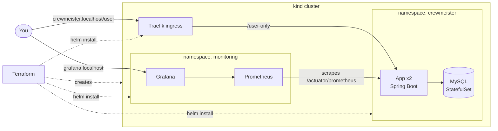

# Crewmeister DevOps Challenge

A Spring Boot user API (Java 17, MySQL, Flyway) packaged with Docker, deployed with a Helm chart
through Terraform onto a local Kubernetes cluster ([kind](https://kind.sigs.k8s.io/)), monitored with
Prometheus and Grafana, and built, tested and scanned by GitHub Actions.

Everything runs locally with free, public tools. No cloud account is needed.

## Contents

- [What was asked and where it is](#what-was-asked-and-where-it-is)
- [Architecture](#architecture)
- [Quick start](#quick-start)
  - [Option 1: Docker Compose](#option-1-docker-compose-fastest)
  - [Option 2: Kubernetes with Terraform](#option-2-kubernetes-with-terraform-the-full-setup)
- [Using the API](#using-the-api)
- [Monitoring](#monitoring)
- [CI pipeline](#ci-pipeline)
- [Helm chart](#helm-chart)
- [Repository layout](#repository-layout)
- [Design decisions](#design-decisions)
- [Security](#security)
- [What was tested, and known limitations](#what-was-tested-and-known-limitations)

## What was asked and where it is

| Requirement | Where |
|---|---|
| Dockerfile | [Dockerfile](Dockerfile), [.dockerignore](.dockerignore) |
| Helm chart | [charts/crewmeister](charts/crewmeister) |
| Terraform to interact with the Kubernetes cluster | [terraform/](terraform) (module + kind environment) |
| Runs on a local machine | Docker Compose, and a local kind cluster created by Terraform |
| Plus: CI pipeline in GitHub | [.github/workflows/ci.yml](.github/workflows/ci.yml) |
| Plus: monitoring | kube-prometheus-stack, a Grafana dashboard and alert rules (chart + [monitoring.tf](terraform/envs/kind/monitoring.tf)) |
| Extra: vulnerability scanning | Trivy in CI, report-only (see [Security](#security)) |

## Architecture



Terraform creates the cluster, builds and loads the image, then installs three Helm releases in
order: Traefik (ingress), kube-prometheus-stack (monitoring) and the application chart.

## Quick start

### Option 1: Docker Compose (fastest)

Needs only Docker.

```bash
docker compose up --build
```

The app is on <http://localhost:8080>. Stop with `docker compose down -v`.

### Option 2: Kubernetes with Terraform (the full setup)

**Prerequisites:** Docker, [kind](https://kind.sigs.k8s.io/docs/user/quick-start/#installation),
[Terraform](https://developer.hashicorp.com/terraform/install) 1.5+ and `kubectl`. Port 80 on your
machine must be free (it is mapped to the ingress controller).
`*.localhost` names resolve to your own machine, so no `/etc/hosts` edit is needed.

```bash
cd terraform/envs/kind
terraform init
terraform apply
```

This creates the cluster `crewmeister`, builds and loads the image, and installs Traefik, the
monitoring stack and the app. **The first run takes roughly 10 to 15 minutes**, mostly pulling the
monitoring images. Later runs only change what differs.

When it finishes:

```bash
curl 'http://crewmeister.localhost/user?id=1'
# Greetings from Crewmeister, Alice!
```

Remove everything with `terraform destroy` (run it in the same folder).

## Using the API

| Method | Path | Description |
|---|---|---|
| `GET` | `/user?id=<id>` | Returns a greeting for the user with this id. `id=1` ("Alice") is created by the Flyway migration. |
| `POST` | `/user` | Creates a user from `{"name": "<name>"}` |

```bash
curl -X POST http://crewmeister.localhost/user -H 'Content-Type: application/json' -d '{"name":"Tarek"}'
curl 'http://crewmeister.localhost/user?id=1'
```

On Kubernetes the ingress only routes `/user`. The Actuator endpoints (`/actuator/health`,
`/actuator/prometheus`) are deliberately **not** reachable from outside the cluster; use
`kubectl -n crewmeister port-forward svc/crewmeister-crewmeister 8080:80` to reach them.

## Monitoring

- **Grafana:** <http://grafana.localhost>, user `admin`. The password is generated per install:

  ```bash
  kubectl -n monitoring get secret monitoring-grafana -o jsonpath='{.data.admin-password}' | base64 -d
  ```

  The dashboard **Crewmeister app** is provisioned automatically: alert state, request rate, 5xx rate,
  latency, JVM heap, database connections and the number of healthy instances.
- **Prometheus:** `kubectl -n monitoring port-forward svc/monitoring-kube-prometheus-prometheus 9090`,
  then open <http://localhost:9090/alerts>.
- **Alerts** (defined in [prometheusrule.yaml](charts/crewmeister/templates/prometheusrule.yaml)):
  - `CrewmeisterDown`: no healthy instance scraped for 2 minutes.
  - `CrewmeisterHigh5xxRate`: more than 5% of requests failing with 5xx for 5 minutes.
- **See an alert fire:**

  ```bash
  kubectl -n crewmeister scale deploy/crewmeister-crewmeister --replicas=0   # wait about 2 minutes
  kubectl -n crewmeister scale deploy/crewmeister-crewmeister --replicas=2   # restore
  ```

Alertmanager is disabled: with nowhere local to send notifications, alerts are visible in
Prometheus and Grafana only.

## CI pipeline

[.github/workflows/ci.yml](.github/workflows/ci.yml) runs on pull requests and on pushes to `main`:

| Job | What it does |
|---|---|
| `test` | `./mvnw verify` against a MySQL 8.4 service container |
| `helm` | `helm lint` and a render with monitoring enabled |
| `terraform` | `fmt -check`, `init -backend=false`, `validate` |
| `scan-repo` | Trivy: secrets and misconfigurations in the Dockerfile, chart and Terraform. Findings go to the Security tab. |
| `image` | Builds the image, scans it with Trivy (findings go to the Security tab), and on pushes to `main` publishes it to GHCR as `ghcr.io/<owner>/<repo>:<git sha>` and `:latest` |

Trivy findings are listed under the repository's
[code scanning alerts](https://github.com/tarek-gritli/devops-coding-challenge/security/code-scanning)
(tool Trivy, categories `trivy-repo` and `trivy-image`) and in each run's job summary.

The `image` job only starts after `test`, `helm` and `terraform` pass. CI stops at publishing a tested
image: the target cluster is local, so there is nothing for CI to deploy to.

To run the tests locally you need a JDK 17+ and a MySQL on `localhost:3306` (`root` / `dev`, database `challenge`):

```bash
docker run -d --rm --name tmp-mysql -e MYSQL_ROOT_PASSWORD=dev -e MYSQL_DATABASE=challenge -p 3306:3306 mysql:8.4
./mvnw -B verify
docker stop tmp-mysql
```

`mvnw` uses `JAVA_HOME` before the `java` on your `PATH`, so make sure it points to a JDK, not a JRE.

## Helm chart

[charts/crewmeister](charts/crewmeister) can also be installed without Terraform on any cluster:

```bash
helm install crewmeister charts/crewmeister -n crewmeister --create-namespace \
  --set image.repository=<image> --set image.tag=<tag>
```

Main values (see [values.yaml](charts/crewmeister/values.yaml) for all):

| Value | Default | Meaning |
|---|---|---|
| `replicaCount` | `2` | App replicas |
| `image.repository`, `image.tag` | GHCR image, `latest` | Image to run |
| `mysql.enabled` | `true` | Deploy a bundled single-instance MySQL. Set `false` to use a managed database. |
| `externalDatabase.*` | empty | Host, port, database and credentials when `mysql.enabled=false` |
| `ingress.enabled`, `.className`, `.host` | `false` | Expose `/user` through an ingress controller |
| `serviceMonitor.enabled` | `false` | Also creates the ServiceMonitor, Grafana dashboard and alert rules (needs the Prometheus Operator CRDs) |

By default the database password is generated on first install and kept across upgrades. The app
always reads it from a Kubernetes Secret. (You can set `mysql.rootPassword` or
`externalDatabase.password` yourself, but then the value goes through your Helm values.)

## Repository layout

```text
.
├── Dockerfile, docker-compose.yml   # image and local run
├── charts/crewmeister/              # Helm chart (app, MySQL, ingress, dashboard, alert rules)
├── terraform/
│   ├── modules/app/                 # reusable: installs the chart on any cluster
│   └── envs/kind/                   # local environment: cluster, image, Traefik, monitoring, app
├── .github/                         # CI workflow and Dependabot config
└── src/                             # the Spring Boot application (unchanged apart from pom.xml)
```

## Security

- Containers run as non-root with a read-only root filesystem, no privilege escalation and all
  capabilities dropped (app and MySQL). Writable scratch space is limited to `emptyDir` volumes.
- Secrets live in Kubernetes Secrets. Terraform state files and the generated kubeconfig are git-ignored
  because they contain cluster credentials.
- **Trivy runs in CI in report-only mode:** findings appear in the job summary and in the repository's
  Security tab (code scanning, categories `trivy-repo` and `trivy-image`), and never fail the pipeline.
  An alert stays open until the vulnerable dependency is upgraded out of the image, or until it is
  dismissed in the Security tab with a reason.
- **Every GitHub Action is pinned to a commit SHA**, not a tag, with the release in a comment. Tags
  can be moved: in March 2026 the version tags of Trivy's action were force-pushed to malware
  (GHSA-69fq-xp46-6x23). Trivy itself is pinned to an explicit version too. **Dependabot**
  ([dependabot.yml](.github/dependabot.yml)) opens weekly pull requests for the actions, Maven
  dependencies and Terraform providers. The Docker base image is left out on purpose: its Java
  version and Ubuntu release are chosen deliberately, and Trivy reports its vulnerabilities.
- CI runs on `ubuntu-26.04` instead of `ubuntu-latest`, the same Ubuntu release as the image's base
  (`eclipse-temurin:17-*-resolute`), so neither can change without a commit.
- At the last scan, the chart and Dockerfile had **no HIGH/CRITICAL findings**. The image had
  **41 HIGH/CRITICAL**: 38 in the application's Java dependencies (Spring Boot 3.3.5, which pins
  Tomcat 10.1.31, Spring 6.1.14 and `jackson-databind` 2.15.0) and 3 in a Go binary in the base image.
  These versions come with the supplied project and Spring Boot 3.3.x is out of open-source support.
  They are reported, not fixed or enforced, because changing the application's framework version was
  outside the task. The next step would be moving to a supported Spring Boot release, then turning
  on enforcement (`--exit-code 1`).
